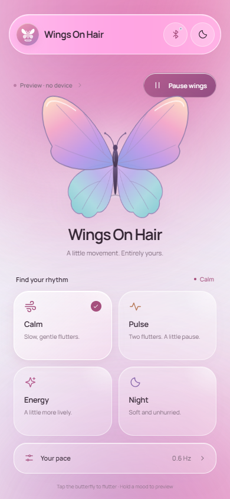
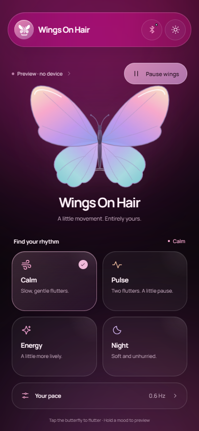
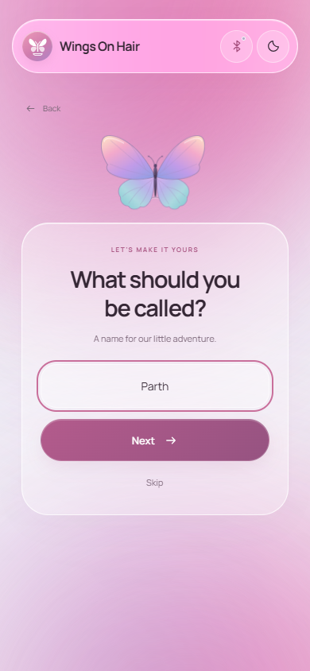
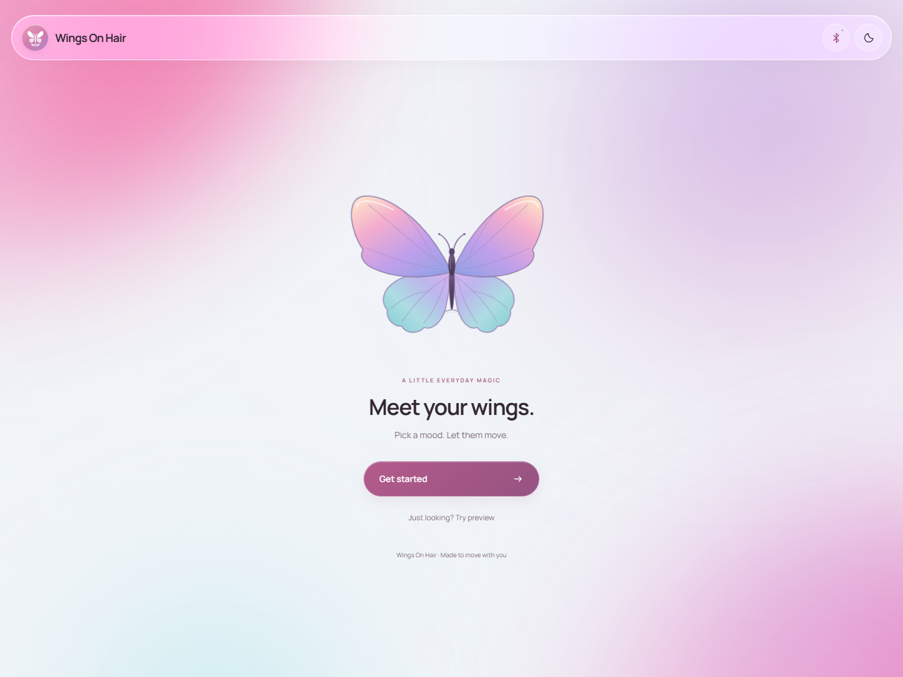
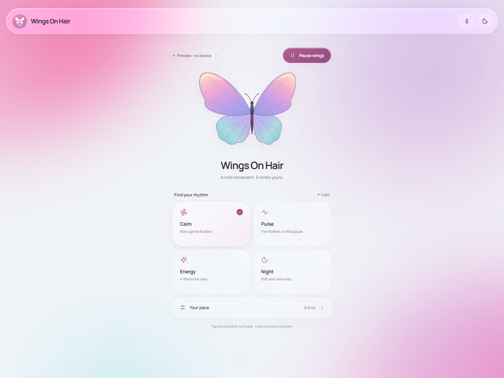
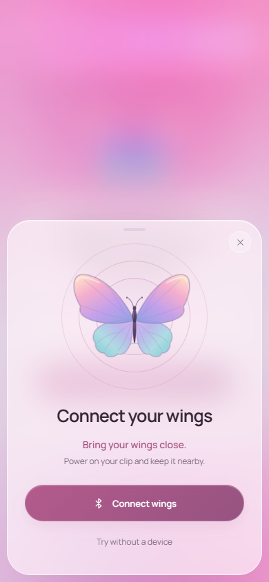
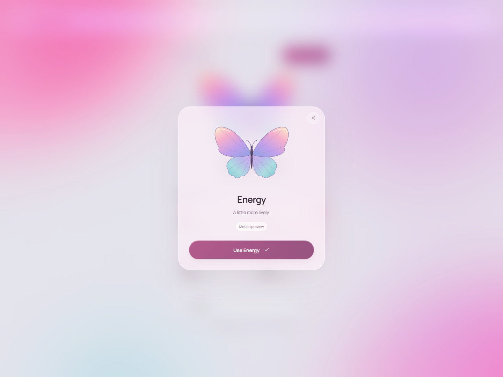
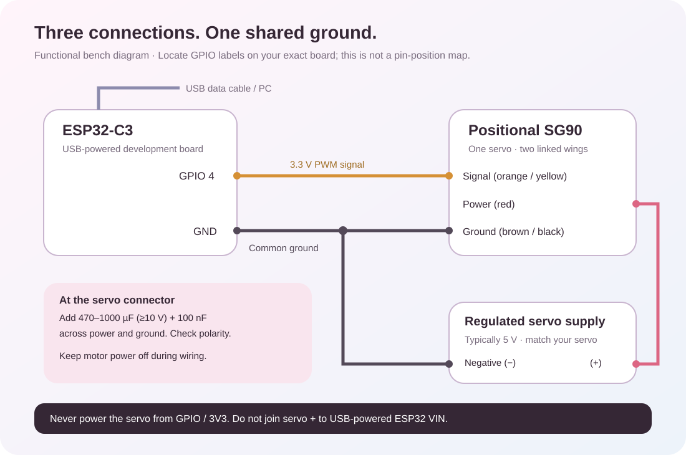

<p align="center"></p>
<h1 align="center">Wings On Hair</h1>
<p align="center">A little movement. Entirely yours.<br>Android app · ESP32-C3 firmware · A butterfly you can build</p>
<p align="center"><a href="https://github.com/ParthSancheti/WingsOnHair/releases/latest">Download APK & firmware</a> · <a href="docs/HARDWARE.md">Parts & wiring</a> · <a href="docs/CUSTOMIZE.md">Make your own version</a></p>

**Version 2.5 · Created by [Parth Sancheti](https://github.com/ParthSancheti)**

A simple companion for a moving butterfly hair clip. Your phone sends Bluetooth LE commands to an ESP32-C3; one positional SG90 servo moves two mechanically linked wings. This repository includes the complete app, native Android project, Arduino firmware, illustrated wiring guide, and build instructions. No account, backend, or paid API is needed.

## See it

<p align="center">
  
  
  
</p>

<details><summary>Welcome, desktop, connection and long-press preview</summary>






</details>

These are actual browser renders. The background moves in the app; screenshots are still images. Preview mode is explicitly labelled and works without an accessory.

## Pick your starting point

| You want to… | Start here |
| --- | --- |
| Try it immediately | [Download the debug APK](https://github.com/ParthSancheti/WingsOnHair/releases/latest), or run the web preview below |
| Build the physical clip | [Parts, wiring, assembly and calibration](docs/HARDWARE.md) |
| Flash an ESP32-C3 | [Firmware setup and binary protocol](firmware/README.md) |
| Change the name, colors or motion | [Customization guide](docs/CUSTOMIZE.md) |
| Build your own APK | [Android setup and device checks](docs/ANDROID.md) |
| See what was tested | [Verification report](docs/VERIFICATION.md) |

## Run locally

Install **Node.js 22.12+** (Node 24 was used here) and Git:

```sh
git clone https://github.com/ParthSancheti/WingsOnHair.git
cd WingsOnHair
npm ci
npm run dev
```

Open the address Vite prints, normally `http://localhost:5173`. **Just looking? Try preview** works without hardware. **Get started** follows the animated welcome, optional name entry and connection radar. Names and settings stay on your device.

Browser Bluetooth needs supported Chrome/Edge at `localhost` or HTTPS. A plain HTTP LAN address on a phone does not enable Web Bluetooth. The APK uses native Bluetooth.

## Use your wings

1. Power the accessory. Tap Bluetooth, then **Connect wings**, and select `WingsOnHair`. Allow the phone's Bluetooth permissions.
2. Choose **Calm**, **Pulse**, **Energy**, or **Night**. Selecting a mood starts movement when connected or in Preview.
3. Use **Start/Pause** above the butterfly. **Your pace** adjusts frequency from 0.2 to 3.0 Hz.
4. Tap the butterfly for one quick flutter that returns to the previous motion. Hold a mood to preview it locally; choose **Use…** to apply it.
5. Use the moon/sun for appearance. Tap the circular app icon for About, update checks, and Replay welcome.

| App mood | Firmware mode | Motion |
| --- | --- | --- |
| Calm | 1 · Velvet Breeze | Slow, gentle flutters |
| Pulse | 2 · Golden Pulse | Two flutters and a pause |
| Energy | 3 · Euphoria Rush | A faster rhythm |
| Night | 4 · Midnight Serenade | Soft, unhurried movement |

## Design and animation

One screen, a floating pill title bar, circular logo, four rounded glass cards and colored vector wings. Pink fluid orbs use 100–140 px blur, 25-second clockwise and 22-second counter-clockwise motion, and a bounded 20-second hue shift. Light mode blends pastel ink over `#f0f4f8`; dark mode blends glowing colors over `#050508`.

First-run motion includes icon expansion, a butterfly flying from the corner, a welcome settle, staggered spring motion on the optional name step, a connection radar and a home bounce. Presses soften surrounding content; long presses open a blurred preview. Capacitor supplies haptics where supported. Reduced-motion preferences shorten decorative transitions and freeze the fluid background.

No navigation tabs, main-screen telemetry grid, microphone controls or Custom Studio panels. Advanced custom curves remain available through the firmware protocol.

## Build the accessory

Start with one ESP32-C3 board, a positional SG90 with horn, a regulated servo supply, common-ground wiring, a clip base, two light wings and a linkage. The [full bill of materials](docs/HARDWARE.md#parts-list) includes tools and optional portable-power parts.



**Start on the bench with the linkage removed.** Never power the servo from a GPIO or the board's 3.3 V rail. Calibrate before attaching wings or wearing the clip. The diagram is functional, not a physical pin map: locate GPIO 4 and GND on your exact board.

The complete [Arduino sketch](firmware/WingsOnHair_Firmware/WingsOnHair_Firmware.ino) uses nonblocking 20 ms updates, Bezier motion, transient-flutter restoration, six-byte command validation, telemetry and graceful park/detach on stop or disconnect. It compiles with **Arduino-ESP32 3.3.12** and **NimBLE-Arduino 2.5.2**. No Servo library is needed.

```sh
arduino-cli config add board_manager.additional_urls https://raw.githubusercontent.com/espressif/arduino-esp32/gh-pages/package_esp32_index.json
arduino-cli core update-index
arduino-cli core install esp32:esp32@3.3.12
arduino-cli lib install "NimBLE-Arduino@2.5.2"
arduino-cli compile --fqbn esp32:esp32:esp32c3 firmware/WingsOnHair_Firmware
arduino-cli board list
# Replace COM5 with your board's port; Linux/macOS use a /dev/... path.
arduino-cli upload --fqbn esp32:esp32:esp32c3 --port COM5 firmware/WingsOnHair_Firmware
```

Prefer compiling for your board. Prebuilt firmware targets the documented ESP32-C3 configuration; read its included flashing README.

## Build an APK

Install **JDK 21**, **Android SDK Platform 36**, and **Build Tools 36.0.0** through Android Studio. The native project is already included; do not run `cap add android` again.

On Windows, set `JAVA_HOME` / `ANDROID_HOME` if necessary, then:

```powershell
npm run android:build
```

On macOS/Linux, or for a manual build:

```sh
npm run android:sync
cd android
chmod +x gradlew
./gradlew assembleDebug
```

Output: `android/app/build/outputs/apk/debug/app-debug.apk`. Install on Android 7.0+ and allow installation from your download source. This is a **debug build for testing**. Store distribution needs your own release signing key and device acceptance checks. Signing keys are not included. See [ANDROID.md](docs/ANDROID.md).

## Verify a change

```sh
npm test
npm run test:ui
npm run build
```

Local UI tests use installed Chrome. To use bundled Chromium:

```powershell
npx playwright install chromium
$env:PLAYWRIGHT_BROWSER_CHANNEL = 'chromium'
npm run test:ui
```

On macOS/Linux use `PLAYWRIGHT_BROWSER_CHANNEL=chromium npm run test:ui`. GitHub Actions checks web/browser behavior, builds the Android APK and compiles firmware. [Verification scope](docs/VERIFICATION.md) distinguishes software tests from physical testing.

## Project map

```text
app.js                          Welcome, name, home, sheets, lifecycle
style.css                       Fluid background, glass, layout, motion
src/ui.js                       SVG butterfly, logo and icons
src/interactions.js             Press / hold / keyboard feedback
src/services/ble.js             Native BLE, Web Bluetooth, Preview
src/services/protocol.js        Packets, presets, shared motion curves
src/services/updates.js         Public GitHub release lookup
android/                        Android source and Gradle wrapper
firmware/WingsOnHair_Firmware/   Complete ESP32-C3 sketch
firmware/README.md              Flashing, calibration, binary protocol
docs/HARDWARE.md                Parts, wiring, mechanical assembly
docs/CUSTOMIZE.md               Fork, rename, recolor, tune, release
docs/ANDROID.md                 Android setup and device checks
tests/                         Service, interaction and browser tests
.github/workflows/build.yml     CI builds
```

## Measurement limits

The butterfly follows the servo angle **commanded** by the ESP32, subject to radio latency. An SG90 has no measured position output. One motor drives linked wings; two SVG wings do not mean two independent motors.

Battery charge and health cannot be inferred from a regulated ESP32 supply. Firmware defaults to battery unavailable; the opt-in calibrated runtime estimate is labelled and resets on boot. No fabricated voltage or health measurements appear. Flash firmware over USB; the About screen checks GitHub releases but does not install software silently.

## Privacy and reuse

The optional name and preferences stay locally. No analytics, login or cloud database. The app does not activate its retained sensor helper or request microphone access. GitHub receives normal network metadata during update checks and link visits. Default BLE control is not authenticated ownership enrollment: nearby devices can connect while the accessory advertises.

Original code and illustrations use the [MIT License](LICENSE); keep attribution in your version. Dependencies retain their own licenses. Bundled Manrope uses the [SIL Open Font License](docs/licenses/Manrope-OFL.txt). When contributing, include appropriate tests and document hardware results separately from simulations.
