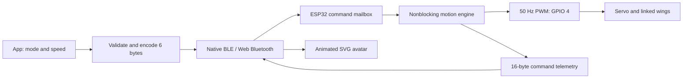

# Make your own version

Start with a working preview, then change one layer at a time. No backend is required.

## Fork and run

Fork this repository on GitHub, then clone **your fork**:

```sh
git clone https://github.com/YOUR_USERNAME/YOUR_REPO.git
cd YOUR_REPO
npm ci
npm run dev
```

Choose **Try preview**. Use `npm test`, `npm run test:ui`, and `npm run build` after changes. The README explains Chrome/Chromium setup for UI tests.

## What to change where

| Goal | Files / symbols |
| --- | --- |
| App title and welcome copy | `app.js`: `render`, `renderView`, `nameMarkup`, `aboutMarkup`; `index.html`: document title |
| Logo and butterfly shape | `src/ui.js`: `logo()` and `butterfly()`; keep unique SVG gradient IDs |
| Browser icon | `public/favicon.svg` |
| Title-bar logo corners | `style.css`: `.floating-bar .brand-icon` |
| Main colors and background | `style.css`: final pink-fluid section, `:root`, dark variables, `.orb-one` through `.orb-four` |
| Motion speed of background | `fluid-clockwise`, `fluid-counter`, `fluid-hue` animations; preserve reduced-motion overrides |
| Mood labels / descriptions | `app.js`: `moods` |
| Actual motion presets | `src/services/protocol.js`: `PRESETS` |
| Servo pin / pulse calibration | Firmware: `SERVO_PIN`, `SERVO_PULSE_MIN_US`, `SERVO_PULSE_MAX_US` |
| BLE name | Firmware `NimBLEDevice::init` and app `DEVICE_NAME` |
| BLE service / characteristic IDs | All three UUIDs in firmware and `src/services/protocol.js` must agree |
| Update repository | `src/services/updates.js` repository defaults; About links in `app.js` |
| Storage namespace | `woh.` prefix in `app.js`; change for a separate app |

CSS includes shared foundation rules followed by the pink-fluid/mobile overrides. Edit the final matching rule or deliberately consolidate it; changing an earlier overridden declaration may have no effect. Do not remove `--safe-*` insets, keyboard focus styles or reduced-motion support.

## Tune a mood

Presets use `{ mode, minAngle, maxAngle, speed, impulseX, impulseY }`. UI speed is Hz; the encoder converts it to frequency ×10. Impulse coordinates are integer percentages. See the existing presets before editing. For example, a custom protocol packet representing mode 5, 20–90°, 0.8 Hz and easing point (35%,65%) is:

```js
const custom = {
  mode: 5, minAngle: 20, maxAngle: 90,
  speed: 0.8, impulseX: 35, impulseY: 65,
};
// encodeCommand(custom) -> six bytes [5, 20, 90, 8, 35, 65]
```

The simple home only exposes modes 1–4. Adding a custom editor requires UI/state work; the packet alone does not create a new card. Valid limits: angle 15–110° with minimum below maximum, speed 0.2–3 Hz, impulse coordinates 5–95. Test with Preview before connecting a mechanism, then calibrate physically with the linkage removed.

## Give your Android fork its own identity

Changing only the title does not make a separate Android application. For a side-by-side install, choose a unique reverse-domain ID such as `com.yourname.butterflyclip` and update all of these together:

1. `capacitor.config.json`: `appId` and `appName`.
2. `android/app/build.gradle`: `namespace`, `applicationId`, `versionCode`, `versionName`.
3. `android/app/src/main/java/com/parthsancheti/wingsonhair/MainActivity.java`: Java `package` and matching directory path.
4. `android/app/src/main/res/values/strings.xml`: app name, title, package name and URL scheme.
5. Review `AndroidManifest.xml` and project-wide references to the old ID. Retain `${applicationId}` placeholders where already used.
6. Update adaptive foreground/background resources and legacy launcher PNGs under `android/app/src/main/res`. Android Studio Image Asset can generate a coherent set from your mark.

Update `package.json`/lockfile version, the app's About/update-check version and CI/release labels together. Increase Android `versionCode` for every installable update. Keep BLE UUIDs if you want compatibility with existing accessories; change them **on both sides** when intentionally creating a separate protocol family.

Build with `npm run android:build` on Windows, or follow [ANDROID.md](ANDROID.md). Use your own release key for distribution, keep it private, and back it up: subsequent updates need the same signing identity. Never commit keys, passwords, `.env`, `local.properties`, SDKs or build caches.

## Share a release

1. Run tests, browser checks, production build and firmware compile. Perform the physical checks in [HARDWARE.md](HARDWARE.md) for your actual mechanism.
2. Update screenshots and [VERIFICATION.md](VERIFICATION.md) to describe what your version truly tested.
3. Commit source and docs to your fork. The included GitHub Actions workflow builds web/Android and firmware artifacts.
4. Create a version tag and GitHub release. Attach your APK, firmware package with board/flash details, and SHA-256 checksums. State whether the APK is debug or release-signed.
5. Keep original attribution and dependency notices. Document differences from the upstream project so builders know which wiring/protocol to follow.

## Protocol and architecture



The browser-only Preview uses the same motion sampler locally. It never claims a real connection. The wire format, UUIDs and all telemetry fields are documented in [firmware/README.md](../firmware/README.md#motion-protocol).

Battery sensing, two independent servos, ownership pairing and firmware OTA require actual hardware/protocol changes. Do not turn placeholders into measured-looking UI or imply those features are already implemented.
