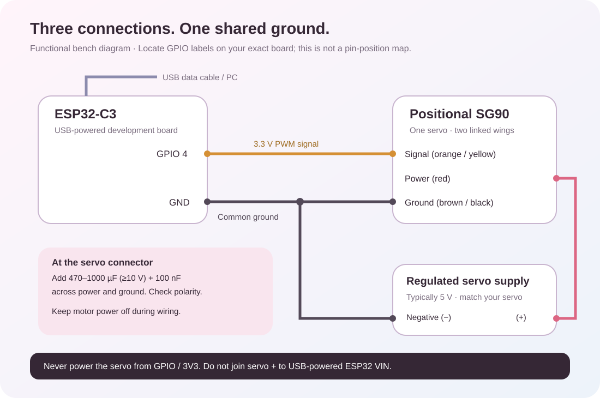
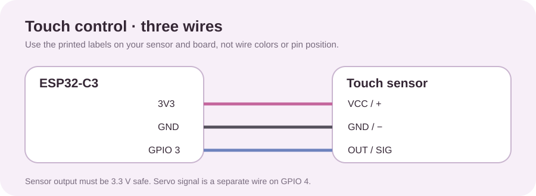

> **v2.7 update:** use the [saved travel and USB slider guide](TRAVEL-AND-OTA.md). Fresh installations keep motion disabled until tested limits are saved. Stored limits apply to every function; the older ranges below describe the historical v2.6 presets.

# Build your butterfly clip

This is a **bench-first prototype**: an ESP32-C3, one positional micro servo and two linked wings. Code and electrical connections are provided. Fit the linkage and enclosure to your parts; there is no tested STL, PCB or production-ready wearable mechanism in this repository.

## Parts list

### Electrical bench build

| Qty | Part | Selection notes |
| --- | --- | --- |
| 1 | ESP32-C3 development board | USB programming, accessible GPIO 4 and GND, published pinout. Build target: ESP32C3 Dev Module, 4 MB flash |
| 1 | Positional SG90-class servo | Include horn and center screw. Do not use a continuous-rotation/360° servo |
| 1 | Three-pin 3.3 V active-high touch module | VCC, GND and OUT; GPIO 3 input for local mode switching |
| 1 | Regulated servo supply | Match your servo; typically 5 V. At least 2 A is a useful starting supply rating for one servo; verify startup/stall demand |
| 1 | USB **data** cable | Matches the board; supplies/programs the ESP32 during bench work |
| 3+ | Insulated wires and connectors | Signal, ground, motor power. Use adequately sized power wires; breadboards are for low-current prototyping |
| 1 | 470–1000 µF electrolytic capacitor, ≥10 V | Suggested starting decoupling near servo connector; verify polarity and tune as needed |
| 1 | 100 nF ceramic capacitor | Across the servo supply near its connector |
| 1 set | Power switch and appropriate current protection | Rated for supply/load; make power-off accessible |

Tower Pro specifies its SG90 at 4.8 V and notes substantial current demand. Voltage limits and travel vary across variants and clones; use your exact servo's specification. [Manufacturer information](https://towerpro.com.tw/product/sg90-7/).

### Clip and mechanism

| Qty | Part | Purpose |
| --- | --- | --- |
| 1 | Hair clip / barrette base | Secure mount and insulated electronics platform |
| 2 | Lightweight wings | Thin foam or PET; keep both sides balanced |
| 2 | Wing pivots / hinges | Low friction, no exposed sharp ends |
| 1 set | Servo horn, crank and two rods | Convert one servo's movement into mirrored flapping |
| 1 | Rigid mount / enclosure | Prevent twisting; keep hair away from joints |
| As needed | Screws, spacers, heat-shrink, strain relief | Secure and insulate assembly |
| Optional | Captive magnets and mating attachments | Quick-swap wings; mechanically retain magnets |

Tools: multimeter, screwdriver, wire stripper, soldering iron, ruler and preferably a current-limited supply. A 3D printer is optional for custom mounts.

### Portable power, optional

The first build should stay on a bench supply. A battery version additionally needs a protected cell/pack, a charger matched to that cell, a power-path circuit or charge/run disconnect, a regulator sized for servo current, connectors, a switch and an insulated enclosure. Battery capacity alone does not establish safe peak current.

A single-cell lithium charger is **not** a 5 V regulator. Use suitable regulation for both the servo rail and your board's specified input. Never connect a fully charged cell directly to 3V3. Do not charge while wearing the clip. Consult your exact board and charger schematics before combining USB, battery and charging paths; there is no universal charger-module wiring assumed here.

The proposed [IP5310 Type-C power-bank module](https://robu.in/product/ip5310-5v-3a-type-c-boost-power-module/) is intended to charge a single lithium cell and boost it to 5 V. The builder reports that it shuts down in their low-load assembly and has set it aside. **Its PCB pad layout has not been verified from the supplied front-side photo.** Do not guess B+, B−, or 5 V output pad positions from the IP5310 chip pinout. Read the PCB labels on both sides, then measure output polarity and voltage with a multimeter before connecting an ESP32 or servo. A protected, correctly rated cell and an insulated mount are still required. The chip's load detector can enter standby at light load. [IP5310 datasheet](https://wiki.geekworm.com/images/c/ce/IP5310-datasheet-en.pdf).

The builder reports a short-running direct-battery prototype. Its exact ESP32 battery input, motor model, protection board and voltage range have not been identified, so this guide does **not** turn that report into a universal direct-cell wiring diagram. A bare single lithium cell can reach 4.2 V; the ESP32-C3 chip's 3.3 V supply pins are specified for 3.0–3.6 V. Follow the actual development board's battery-input documentation. A three-wire SG90 servo is specified around 4.8 V; a two-wire DC gear motor needs a different driver and firmware. [Espressif voltage guidance](https://docs.espressif.com/projects/esp-hardware-design-guidelines/en/latest/esp32c3/schematic-checklist.html) · [Tower Pro SG90](https://towerpro.com.tw/product/sg90-7/).

## Wiring

This diagram is functional, not a physical header map. **GPIO 4 is not the fourth pin.** C3 board layouts and power circuits differ.

| From | To | Notes |
| --- | --- | --- |
| ESP32 GPIO 4 | Servo signal, usually orange/yellow | Sketch constant `SERVO_PIN = 4` |
| ESP32 GND | Servo ground and supply negative | All grounds share a reference |
| Regulated servo supply positive | Servo power, usually red | Never GPIO or 3V3 |
| Servo supply negative | Common ground | Short, adequately sized return |
| USB data cable | ESP32 USB socket | Board power/programming in this bench arrangement |
| Bulk + ceramic capacitors | Across servo power and ground near connector | Electrolytic positive to supply positive |

### Touch sensor: change modes without the phone

The current sketch accepts a **three-pin, active-high, 3.3 V touch module** such as a correctly configured TTP223. Its physical pin order depends on the module. Follow the labels printed on the sensor, not its wire colors or left-to-right position.

| Touch module label | ESP32-C3 label | Meaning |
| --- | --- | --- |
| `VCC`, `+`, or `3V3` | `3V3` | Sensor power, only if the sensor supports 3.3 V |
| `GND` or `−` | `GND` | Common ground |
| `OUT`, `SIG`, or `I/O` | `GPIO 3` | Active-high touch signal; maximum 3.3 V |

The sketch uses `TOUCH_PIN = 3` and 50 ms debounce. A short tap cycles **Velvet Breeze → Golden Pulse → Euphoria Rush → Midnight Serenade → Pause → Velvet Breeze**. Holding a finger on the sensor changes the mode only once. Touch works without a phone. The app in v2.6 follows the reported mode and Pause state when connected. A phone command takes control when received; a later touch takes control again. Disconnect parks a phone-controlled mode but does not cancel a touch-controlled mode. Check GPIO 3 on your exact ESP32-C3 board before soldering. Sensor modules with 5 V-only outputs or active-low/toggle behavior need a circuit or firmware change. The v2.5.0 release binary predates this touch addition; compile/upload the v2.6 source or use its firmware package.

After every power-up, the updated sketch waits two seconds and makes one small 45°–60° greeting flap, then parks. Touch or phone control during the wait cancels it. **Test power-up with the linkage removed first**, then adjust `STARTUP_FLAP_MIN_ANGLE` and `STARTUP_FLAP_MAX_ANGLE` to suit your mechanism.

The builder reports a **150 mAh** cell. The v2.6 firmware exposes an estimated runtime percentage using that capacity and assumed current draw. It starts at 100% on every boot, so it is only a rough approximation if the cell was fully charged first. It is not a voltage reading, battery health, a low-voltage cutoff, or charging protection. Measure actual current and tune `ESTIMATE_IDLE_MA` and `ESTIMATE_SERVO_EXTRA_MA` before relying on it.

### Why the AO3401A MOSFET is optional

The [AO3401A](https://www.umw-ic.com/static/pdf/bc46330f4060c89950273e529b41d8f5.pdf) is a **P-channel power switch**, not a touch sensor or a mode selector. It can turn the servo's 5 V power branch on or off electronically, while the ESP32's GPIO 4 still supplies the movement signal. Its SOT-23 pins are **1 Gate, 2 Source, 3 Drain**. It needs an adapter PCB and a gate-driver circuit; a 3.3 V ESP32 output should not be connected directly to its gate when its source is at 5 V. The current firmware does not control a MOSFET, so leave this part out of the first working build. Use a slide switch rated for the load as the manual power switch. Add electronic servo power switching only after the basic battery, touch and servo setup is tested and the extra driver parts are specified.

**Do not connect the external servo positive rail to ESP32 5V/VIN while USB also powers the board unless its documented power circuit supports that.** Here, only ground and signal are shared. Espressif describes mutually exclusive supply options for its reference DevKitM-1; verify the schematic of your particular board. [Espressif board/power guide](https://documentation.espressif.com/esp-dev-kits/en/latest/esp32c3/esp32-c3-devkitm-1/index.html).

Keep motor-current returns out of thin signal wires. Resets during movement usually warrant checking voltage sag, connectors and current capacity. Capacitors help transients but cannot replace a suitable supply. Confirm connector polarity before applying power.

The ESP32 supplies a 3.3 V control signal. Confirm the servo accepts it; otherwise use a suitable unidirectional level buffer. Never apply 5 V to an ESP32 GPIO.

## Flash

1. Leave the linkage/horn disconnected and motor power off. Connect ESP32 USB.
2. Follow the pinned [firmware installation/upload instructions](../firmware/README.md#build-and-upload). Select **ESP32C3 Dev Module**.
3. Confirm `SERVO_PIN` against your board. Change it before compiling if GPIO 4 is unavailable.
4. Upload and open the serial monitor at 115200 baud. If needed, check cable/driver and the board's BOOT/RESET sequence.
5. Power off, wire the servo, inspect polarity/ground, then apply power. Boot generates no servo PWM until a movement command arrives.

Prebuilt firmware targets the documented 4 MB ESP32-C3. Compile the sketch for your board instead of guessing flash offsets. The firmware archive has its own flashing README.

## First movement and calibration

1. Start with a free servo shaft. Keep hair, fingers and wires away from the horn.
2. Connect in the app and select **Calm**. Keep the power switch accessible. Check that Pause parks and then detaches PWM.
3. The starting mapping is 600–2400 µs for nominal software angles 0–180°. The allowed 15–110° range therefore maps to approximately 750–1700 µs. These are parameters, not guaranteed physical angles or limits for your servo.
4. If it buzzes, hits a stop or draws excessive current, cut power. Narrow `SERVO_PULSE_MIN_US` / `SERVO_PULSE_MAX_US` and reflash. A starting mapping such as 1000–2000 µs reduces travel but still needs validation.
5. Find a safe rest position. Switch off before attaching or repositioning the horn. Do not force a powered shaft.
6. Fit a light linkage, run slowly, and check the complete sweep for binding. Adjust linkage length/lever radius, or narrow preset travel in `src/services/protocol.js`.
7. Check all modes, intended maximum speed, flutter, Pause, app backgrounding and Bluetooth disconnection. Inspect heat, resets, clip stability and wiring through repeated cycles before wearing.

Stop or a disconnect during phone control parks over 450 ms, holds 250 ms, then detaches PWM. A touch-selected mode continues without the phone until the next touch or a physical power-off. Detachment removes commanded holding torque, **not servo power**. Design the mechanism to rest safely without torque. Packet loss alone is not an emergency stop; use the physical power switch for servicing.

## Mechanism

Use a servo horn/crank with one rod to each wing lever. Orient the pivots so both wings rise in mirrored motion. Avoid straight-through, dead-center linkage positions. Start with short, light wings. Horn radius and hole spacing determine travel and torque; the illustration is not to scale.

The app has two SVG wings, but the firmware drives **one motor**. Independent hardware movement requires a second output, revised packets and app changes.

## Troubleshooting

| Symptom | Check |
| --- | --- |
| Device missing | Correct firmware/board, ESP32 power, no other connected phone, Bluetooth and permissions |
| Connected but still | Choose a mode; inspect servo power, common ground, signal pin and polarity |
| Jerks / board resets | Supply sag, thin wiring, loose ground, binding, decoupling |
| Wrong direction | Horn/linkage geometry; power off before repositioning |
| Buzzing at an endpoint | Mechanical stop or pulse mismatch; cut power and narrow travel |
| Avatar slightly ahead | Avatar reports commanded angle; physical motion also depends on load/radio latency |
| No battery percentage | Expected by default; regulated voltage cannot reveal charge. Runtime estimate requires calibration |
| Upload fails | Board/port selection, data cable, serial monitor closed, BOOT/RESET |

No physical accessory was available for verification. Include your board model, servo variant, wiring photo and measured behavior in hardware reports. [Verification scope](VERIFICATION.md).
